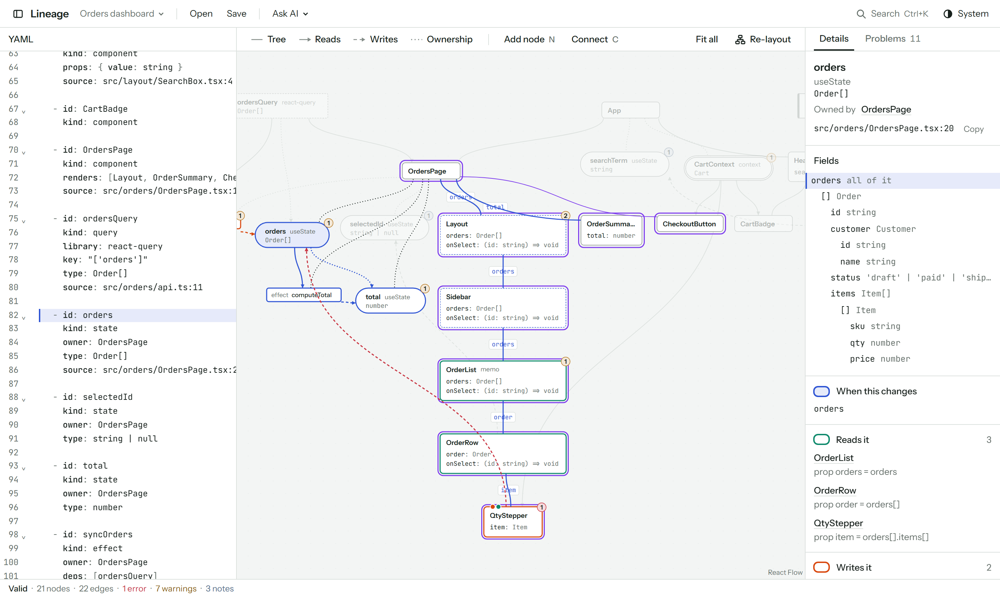

# Lineage

See how data flows through a React feature: who owns it, who reads it, who
changes it, what re-renders when it changes, and which React rules the design
breaks.

<picture>
  <source media="(prefers-color-scheme: dark)" srcset="docs/images/impact-dark.png" />
  
</picture>

You describe a feature in a `.flow.yaml` file: its components, state, context,
stores, queries and effects, and how data moves between them. Lineage draws
it, simulates re-renders, shows the impact of changing any field, and checks
the design against React rules.

- **Runs fully offline.** No network requests, no CDN, no telemetry. The fonts
  are bundled.
- **No AI inside the app.** It reads a plain text file. Any AI (or you) can
  write that file using [docs/FORMAT.md](docs/FORMAT.md).
- **React only, for now.** Support for other front-end libraries is planned.

## Two ways to use it

**Before coding.** Write or draw the plan, fix the rule warnings, then copy it
as a prompt for an AI to implement (Ask AI → Copy prompt: diagram → code).

**After coding.** Give `docs/FORMAT.md` to an AI such as GitHub Copilot and ask
it to describe existing code as a `.flow.yaml`. Open the file in Lineage to
understand the flow and spot problems. The built-in code reader can then
compare the AI's answer with the real source, without AI.

## Quick start

Needs Node.js 22 or newer.

```bash
git clone https://github.com/restaadiputra/lineage.git
cd lineage
npm install
npm run dev
```

Open the address Vite prints. The first run loads a sample, an orders
dashboard with deliberate flaws. Click the `orders` node to get the view in
the screenshot, then open the Problems tab.

## The flow file

```yaml
version: 1
name: Orders page

types:
  Order: { id: string, status: "'draft' | 'paid'" }

nodes:
  - id: OrdersPage
    kind: component
    renders: [OrderList]
    source: src/orders/OrdersPage.tsx:12

  - id: orders
    kind: state
    owner: OrdersPage
    type: Order[]

  - id: OrderList
    kind: component
    memo: true
    props: { orders: "Order[]" }

edges:
  - { kind: prop, from: OrdersPage, to: OrderList, name: orders, data: orders }
```

The full format, written so an AI can follow it exactly, is in
[docs/FORMAT.md](docs/FORMAT.md). The complete sample is
[src/samples/orders.flow.yaml](src/samples/orders.flow.yaml).

## What it does

| Feature | What you get |
|---|---|
| Diagram | Automatic layout, one shape per kind of node, and filters for tree, reads, writes and ownership edges. |
| Impact view | Select a piece of data to light up its readers, writers, the props that carry it, and every component that re-renders. Pick a single field to narrow it. |
| Rules | 13 checks, each with an explanation and a fix. You can ignore one with a reason, which is written into the file. |
| YAML editor | Edits redraw the diagram. Errors are marked on their line, and the last valid diagram stays visible while the text is broken. |
| Canvas editing | Add a node (`N`) or connect two nodes (`C`). The change is spliced into the YAML without reformatting the rest. |
| Plan versus code | Compare two flow files as one merged diagram: plan only, code only and changed. |
| Code reader | Reads a folder of React source with ts-morph and turns it into a flow, to cross-check what an AI wrote. |
| Files | Open, save and drag and drop. In Chrome and Edge the open file is watched, so edits by another tool appear at once. |
| Layout file | Export node positions as `.flow.layout.json` to share them in the repository. |
| VS Code extension | A diagram editor for `*.flow.yaml` beside the text. See [vscode/README.md](vscode/README.md). |

### Rules

| Rule | What it catches |
|---|---|
| `mutation` | State changed in place, or by a component that does not own it |
| `effect-loop` | An effect that sets something in its own dependencies |
| `effect-chain` | One effect triggering another through state |
| `effect-derived-state` | An effect that only syncs state from other React data |
| `derived-state` | Stored state that could be computed while rendering |
| `server-state-copy` | Server data copied into local state |
| `prop-drilling` | Data passed through components that do not use it |
| `unstable-memo-prop` | A new function or value passed to a `memo` component on every render |
| `busy-context` | A context that re-renders many consumers on every change |
| `list-key` | A list rendered with no key, or keyed by index |
| `state-too-high` | State that could live lower in the tree |
| `whole-store` | A component subscribed to an entire store |
| `duplicate-state` | Two places holding the same data |

### Keyboard

| Keys | Action |
|---|---|
| `Ctrl/Cmd+K` | Search for a node |
| `Ctrl/Cmd+O`, `Ctrl/Cmd+S` | Open, save |
| `Ctrl/Cmd+E` | Show or hide the YAML editor |
| `N`, `C` | Add a node, connect the selected node |
| `Esc` | Clear the selection |

## Limits

- It is a model, not a profiler. Lineage reasons about the flow file, so the
  diagram is only as accurate as that file.
- The code reader is static and matches by name. It does not follow custom
  hooks, spread props, renamed imports, or Redux, Jotai and MobX.
- Canvas editing only adds. Deleting, renaming and changing fields are done in
  the YAML.
- The VS Code extension is not on the marketplace. Build it from this
  repository.

The full list, with notes on where each item would start, is in
[docs/ROADMAP.md](docs/ROADMAP.md).

## Development

```bash
npm test             # unit and component tests (Vitest)
npm run test:e2e     # Playwright in Chromium, Firefox and WebKit; first run needs: npx playwright install
npm run lint         # oxlint
npm run build        # type check and production build
npm run build:vscode # VS Code extension: webview bundle and extension
npm run test:vscode  # runs the extension inside a real VS Code
```

Built with React 19, TypeScript, Vite, zustand, React Flow, ELK, CodeMirror
and zod.

The code is layered so that dependencies point inward: `src/model` and
`src/analysis` (pure engine) ← `src/app` and `src/canvas` (application logic,
no React or browser globals) ← `src/adapters` and `src/ui` ← `src/main.tsx`.
[CLAUDE.md](CLAUDE.md) has the full map and the conventions.

## Built with AI

This project was written by AI. I set the goal, the design direction and the
scope; the code, tests and documentation were produced with
[Claude Code](https://claude.com/claude-code) and committed under my name.

- [CLAUDE.md](CLAUDE.md) is the brief the AI worked from: the specification,
  architecture and conventions. It is kept in the repository on purpose.
- The engine, application layer and UI are covered by automated tests, and
  the end-to-end tests fail if the app makes any network request.
- It has not been proven on a large real codebase yet. Expect rough edges,
  and please open an issue when you find one.

The app itself contains no AI and calls no AI service.

## Contributing

Issues and pull requests are welcome. Before opening a pull request, run
`npm test`, `npm run lint` and `npm run build`. Read
[docs/ROADMAP.md](docs/ROADMAP.md) first if you want to pick up a missing
feature.

To report a security problem, see [SECURITY.md](SECURITY.md).

## License

[MIT](LICENSE)
